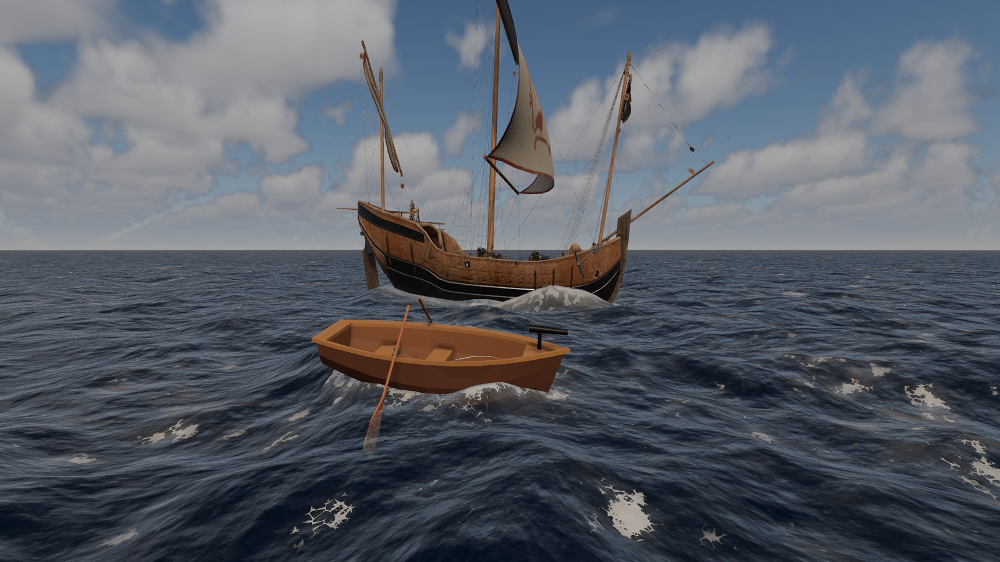
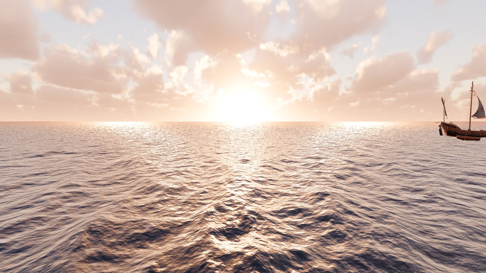
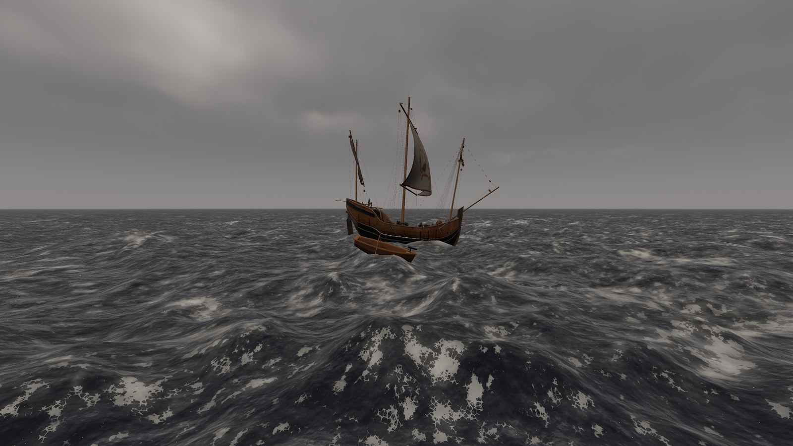
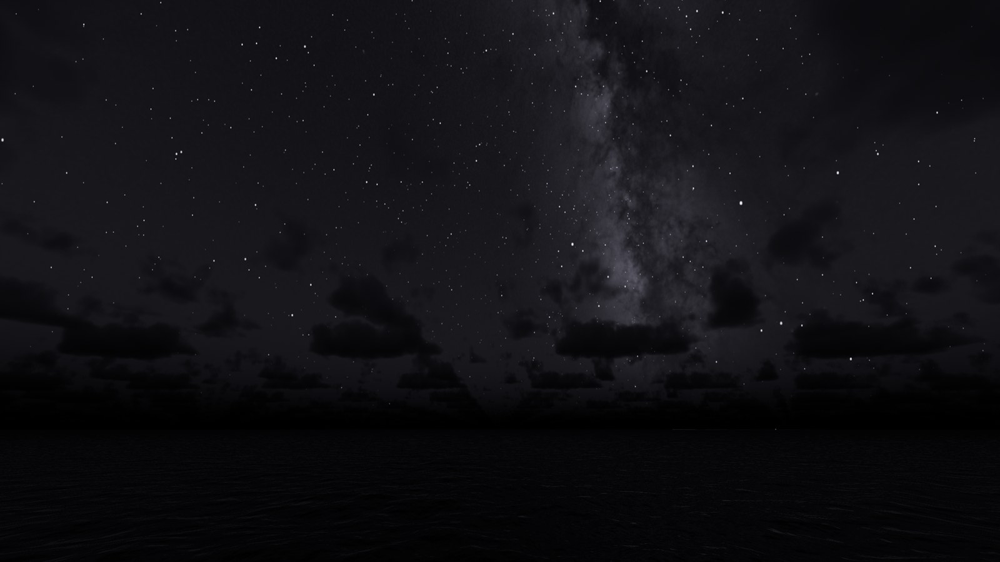

# Godot-RealisticEnvironments

[English](README.md) · **简体中文**

适用于 Godot 4.8 的基于物理的开阔海洋。它包括延伸到弯曲地平线的 FFT 海浪、带大气的
物理天空、体积云和夜空、像人眼一样的曝光，以及可驾驶的船只。



| | |
| --- | --- |
|  |  |
|  | |

## 工作原理

本项目是一组 Godot 插件。每个插件只做一件事，并且可以单独使用。插件之间通过小型约定
连接，而不是直接引用彼此的类型。

| 插件 | 作用 |
| --- | --- |
| [`gre_core`](addons/gre_core/README.zh-CN.md) | 共用的约定（`GREWaterSurface`、`GREWindSource`）和 GPU 辅助工具。 |
| [`gre_wind_system`](addons/gre_wind_system/README.zh-CN.md) | 一股带阵风的风，海浪和云都跟随它。 |
| [`gre_ocean_system`](addons/gre_ocean_system/README.zh-CN.md) | 在 GPU 上计算的 FFT 海浪和延伸到地平线的多细节层次网格；还有水体着色、泡沫、反射、船只尾迹和水面高度查询。 |
| [`gre_sky_system`](addons/gre_sky_system/README.zh-CN.md) | 按天文规律运行的太阳和月亮、物理大气、体积云、星星和行星。它照亮场景并测量光照。 |
| [`gre_exposure_system`](addons/gre_exposure_system/README.zh-CN.md) | 根据测得的光照为相机曝光，像人眼一样适应。 |
| [`gre_buoyancy_system`](addons/gre_buoyancy_system/README.zh-CN.md) | 让刚体漂浮：以设定的吃水深度静止，随波起伏，顺风漂移。 |
| [`gre_hitbox_damage_system`](addons/gre_hitbox_damage_system/README.zh-CN.md) | 投射物受击区和按分组的生命值（例如船体、桅杆）。 |
| [`gre_ocean_environment`](addons/gre_ocean_environment/README.zh-CN.md) | 把风、天空、海洋和曝光放在一个接好线的场景里。 |
| [`gre_boat_template`](addons/gre_boat_template/README.zh-CN.md) | 接好线的船：浮力、驾驶、生命值和相机锚点。 |

```
GREWindSystem --- wind ---> GREOceanSystem <--- sky source --- GRESkySystem --- light ---> GREExposureController
    |                     |      ^                           ^
    +---------------------|------|--- wind (cloud drift) ----+
                registers |
                          v
      GREWaterSurface (core): async height queries
```

- 风（`GREWindSystem`）驱动海浪和云的漂移；天空（`GRESkySystem`）为海洋提供太阳、天空、云和
  星星，并为 `GREExposureController` 提供测光。
- 海洋和天空每帧都用 GPU 上的计算着色器渲染：海浪谱和 FFT、大气的查找纹理，以及云。
- 物理代码从不直接访问海洋。它每个物理帧向世界的 `GREWaterSurface` 提交查询点，几帧后
  读取结果，并外推到当前时刻。
- 大多数单位是物理单位：风速用 m/s，光照用勒克斯，水的光学参数按每米计。画面效果来自
  物理，而不是人为的调色。

## 环境要求

- Godot **4.8**，使用 **Forward+** 渲染器。海洋、大气和云需要计算着色器，所以在
  Compatibility 渲染器和无头模式下没有水面和天空。Mobile 渲染器未经测试。
- 桌面级 GPU。本项目在 Windows 和 RTX 4070 Ti 上开发；其他平台未经测试。
- 关闭物理灯光单位（默认即关闭）。

## 使用方法

**试用。** 用 Godot 4.8 打开本文件夹并运行项目（即演示场景 `demo/main.tscn`），或打开
其中一个[示例](examples/README.zh-CN.md)：

| 示例 | 内容 |
| --- | --- |
| `examples/ocean_only.tscn` | 拿来即用的环境和一个自由飞行相机。 |
| `examples/floating_objects.tscn` | 随波起伏的箱子和木桶。 |
| `examples/boat.tscn` | 基于船只模板、可驾驶的船（W A S D）。 |

**在你的项目中使用。**

1. 把 `addons/gre_core` 和你需要的插件复制到项目的 `addons/` 文件夹。每个插件依赖的插件
   见下表。
2. 在 **项目设置 > 插件** 中启用它们。插件会补充项目所需的设置（天空的全局着色器
   uniform 和去色带、船只的输入动作），从不改动已有设置，并打印它添加了什么。
3. 实例化 `addons/gre_ocean_environment/ocean_environment.tscn`，添加一个远裁剪面超过
   地平线的 `Camera3D`（演示场景用 60 公里），然后运行。
4. 要做一艘船，继承 `addons/gre_boat_template/boat.tscn`。

| 插件 | 依赖 |
| --- | --- |
| `gre_core`、`gre_wind_system`、`gre_exposure_system`、`gre_hitbox_damage_system` | 无 |
| `gre_ocean_system`、`gre_sky_system`、`gre_buoyancy_system` | `gre_core` |
| `gre_ocean_environment` | `gre_core`、`gre_wind_system`、`gre_sky_system`、`gre_ocean_system`、`gre_exposure_system` |
| `gre_boat_template` | `gre_core`、`gre_buoyancy_system`、`gre_hitbox_damage_system` |

每个设置在检查器中都有提示，每个类在编辑器帮助中都有页面（按 F1，搜索例如
`GREOceanSystem`）。配置有误的节点会在场景面板中显示警告。编辑器内的说明目前只有英文。

## 演示场景

`demo/main.tscn` 是开发用的沙盒。你驾驶一艘装有船头回旋炮的划艇。场景里有一艘可以
射击的卡拉维尔帆船、一个浮标、一个罗盘 HUD，以及一个隐藏的调试面板，可以实时调整
大多数海洋、天空和风的参数。武器（`gre_projectile_launcher_system`、
`gre_floating_boat_template`）只是演示玩法，不属于开源插件。
`demo/ocean_optics_debug.tscn` 是一个更轻的场景，用来调整水体着色。

| 输入 | 操作 |
| --- | --- |
| W / S | 前进 / 后退 |
| A / D | 左转 / 右转 |
| 空格 | 向瞄准标记开火 |
| 鼠标右键（按住） | 鼠标环顾 |
| C | 切换相机：第三人称 → 第一人称 → 自由视角 |
| 自由视角：W A S D、R / F、Shift、滚轮 | 飞行、上升 / 下降、加速、飞行速度 |
| H 或 \` | 调试面板 |
| F | 全屏（自由视角中也是"下降"） |
| Esc | 退出全屏，释放鼠标 |

## 仓库结构

```
addons/      各插件，每个都有自己的 README
examples/    只使用开源插件的示例场景
demo/        演示场景、船只和第三方模型
systems/     演示用的辅助代码：相机、调试面板、罗盘 HUD
tools/       开发脚本（lint、星表、银河、示例船体）
docs/        设计记录和图片
```

`CONTRIBUTING.md` 说明如何报告问题和提交修改，`AGENTS.md` 是修改代码的工作规则，
`CHANGELOG.md` 列出了变更。这些文件只有英文版。

## 许可证与致谢

- **代码**（插件、示例、演示脚本、工具）：MIT 许可证，见 `LICENSE`
  （© 2026 itzMeerkat）。海浪模拟起源于 Ethan Truong 的
  [2Retr0/GodotOceanWaves](https://github.com/2Retr0/GodotOceanWaves)，MIT 许可证，
  见 `LICENSE_original`（`addons/gre_ocean_system/LICENSE` 中也有一份）。
  `README_original.md` 是上游项目对海浪谱和 FFT 数学的说明。
- **演示模型**（`demo/assets/`）：CC BY 4.0，作者 Ginny Sutton（"Caravel Ship"）和
  Muyaya Concept（"Stylized Low Poly Rowboat with Paddles"、"Red Marine Navigation
  Buoy"）。来源和详情见 `demo/assets/README.md`。插件和示例不使用这些模型。
- **星星**：Bright Star Catalogue（亮星星表）第 5 修订版（Hoffleit & Warren 1991；
  CDS 星表 V/50），由 `tools/bake_star_catalog.py` 烘焙。
- **银河**：NASA/Goddard Space Flight Center Scientific Visualization Studio，
  Deep Star Maps 2020（https://svs.gsfc.nasa.gov/4851），公有领域；
  Gaia DR2：ESA/Gaia/DPAC。由 `tools/bake_milky_way.py` 烘焙。
- **示例船体**：由 `tools/make_example_hull.py` 生成（与代码一样为 MIT 许可证）。
